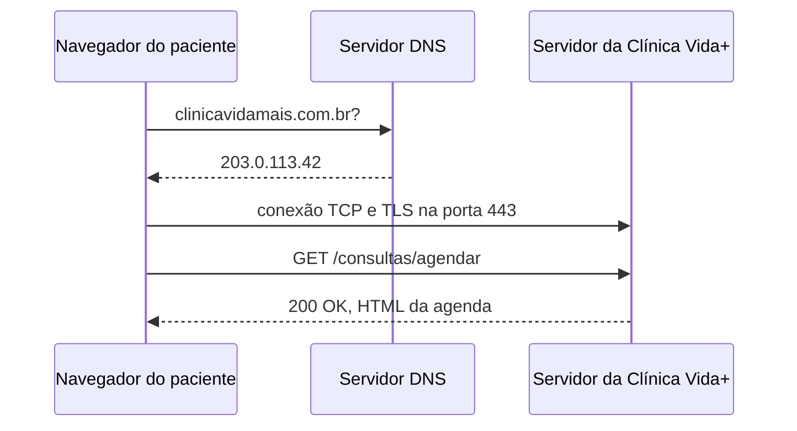

# Arquitetura da aplicação

## O caminho de uma requisição

## Evidência do DNS

Cole aqui a saída real do comando nslookup.

## Evidência do HTTP

| Método | Recurso solicitado | Status |
|---|---|---|
| GET | (seu recurso 1) | (status real) |
| GET | (seu recurso 2) | (status real) |
| GET | (seu recurso 3) | (status real) |
| GET | (seu recurso 4) | (status real) |

## Cabeçalhos HTTP

- Host: (valor encontrado)
- User-Agent: (valor encontrado)
- Content-Type: (valor encontrado)

## Teste de erro 404

- Recurso: /pagina-que-nao-existe
- Status: 404 Not Found

## Capturas de tela

Adicione as capturas de tela das evidências do Network e DNS.
